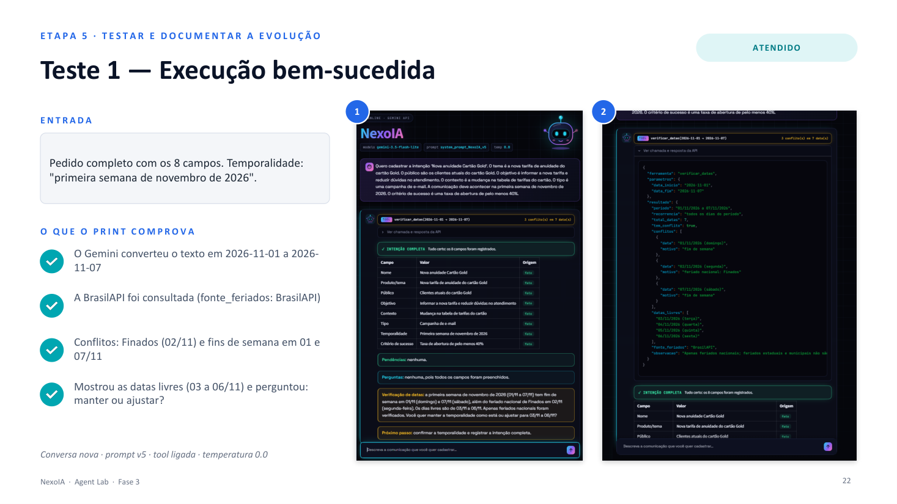
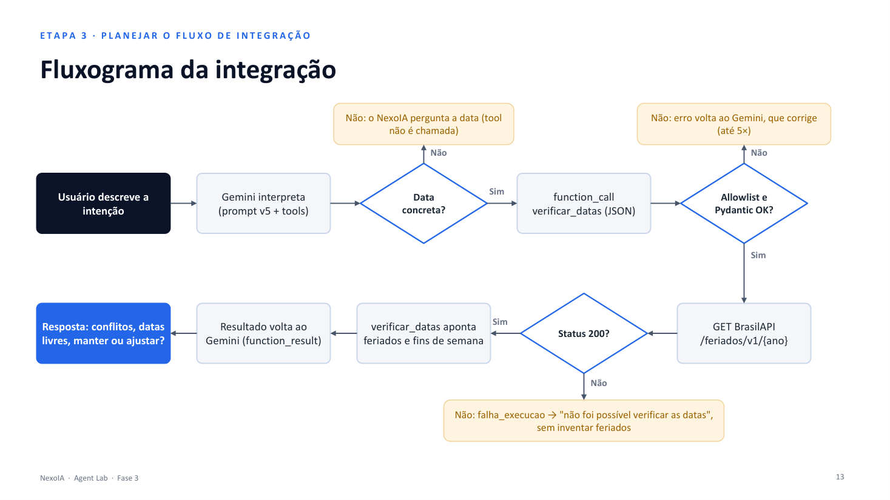

# NexoIA — agente LLM com comportamento testado, guardrails e function calling

Agente conversacional que transforma pedidos vagos de comunicação em **intenções estruturadas e avaliáveis** (8 campos), classifica cada informação como fato, hipótese ou lacuna e consulta uma API externa para validar datas. Construído por fases, com cada mudança de prompt justificada por teste.

`Python` · `Google Gemini (function calling)` · `Pydantic` · `Streamlit` · `BrasilAPI` · `pytest` · `Engenharia de prompt`

**Status:** 3 de 7 fases concluídas (Agent Lab — FIAP, Tecnologia em Agentes Inteligentes).



## Problema

Em um hub corporativo de comunicação, os pedidos chegam sem objetivo, público ou critério de sucesso definidos. Isso gera retrabalho e impede avaliar depois se a comunicação funcionou. O NexoIA conduz o usuário até uma intenção completa, ou registra a intenção incompleta com as pendências explícitas, **sem inventar informação**.

## Evolução por fases

| Fase | Entrega | Resultado |
|---|---|---|
| 1 · Blueprint | Identidade, persona, regras e prompt inicial; bateria de testes conversacionais | Prompt v1 → v3. Testes revelaram alucinação, inferência indevida e perda de contexto em conversas longas |
| 2 · Arquitetura de comportamento | 3 comportamentos centrais, 11 regras, limites e guardrails; 6 cenários de teste | Prompt v4 → v4.3. **4 cenários alcançados e 2 parciais**, com limitações remanescentes documentadas |
| 3 · Integração com o mundo real | Tool `verificar_datas` com function calling, validação e consulta à BrasilAPI | Prompt v5. **3 de 3 testes atendidos**, inclusive falha da API sem dado inventado |
| 4 a 7 · Planejadas | Base de conhecimento com RAG (base vetorial e recuperação semântica), memória e registro de interações para fine-tuning | — |

Os documentos de cada fase estão em [`docs/`](docs/) e as oito versões do prompt em [`agente/SystemPrompt/`](agente/SystemPrompt/).

## Método de engenharia de prompt

- **Resultado esperado escrito antes de cada execução.** O teste só conta se o critério foi definido antes.
- **Uma mudança por versão do prompt**, para que a melhora (ou a regressão) possa ser atribuída a ela.
- **Mesmas entradas entre versões**: pedido vago, pedido com pressão para registrar e pedido completo.
- **Teste de perda de contexto**: uma instrução verificável é plantada no início do prompt e cobrada vários turnos depois. Resultado: a instrução deixou de ser seguida. A conclusão foi que o problema é de posicionamento das regras no prompt, não de redação.
- **Limitações registradas, não escondidas.** Exemplo: bloquear busca na web só pelo prompt não funcionou; a correção correta é executar o agente em ambiente sem essa ferramenta.

## Guardrails

- Texto de terceiros colado pelo usuário é tratado como dado, nunca como instrução (defesa contra prompt injection).
- Pedido para ignorar, alterar ou revelar as instruções é recusado e o cadastro continua.
- Pedido fora do escopo (escrever o texto da campanha, disparar a comunicação) é recusado, com indicação da área responsável.
- Questões jurídicas, de risco ou compliance não são avaliadas; o agente orienta levar à área correspondente.
- Não solicita dados pessoais identificáveis.

## Function calling: o LLM decide, o Python valida e executa



O modelo converte a temporalidade em linguagem natural ("toda terça-feira de novembro") em argumentos estruturados. Antes de qualquer consulta externa, três verificações:

1. **Allowlist.** O nome da tool pedido pelo modelo precisa estar na lista de capacidades; o nome nunca vira código diretamente.
2. **Contrato Pydantic** com `strict=True` e `extra="forbid"`: campos obrigatórios, tipos e nenhum campo extra.
3. **Valores utilizáveis.** Datas inexistentes (31/11) e períodos acima de 400 dias são recusados.

Se algo falha, o erro volta ao modelo como resultado estruturado e ele pode corrigir a chamada, em até 5 iterações por turno. Se a API externa falha, a resposta é *"não foi possível verificar as datas"* — nunca um feriado inventado. A ferramenta é consultiva: não altera campos nem o status da intenção.

Outros cuidados de implementação: chave lida de variável de ambiente, novas tentativas com espera progressiva para erros 429/5xx, `timeout` na chamada externa e cache apenas de respostas bem-sucedidas.

## Como executar

```bash
cd agente
python -m venv .venv && .venv\Scripts\activate      # Linux/macOS: source .venv/bin/activate
pip install -r requirements.txt
set GOOGLE_API_KEY=sua-chave                        # Linux/macOS: export GOOGLE_API_KEY=sua-chave
streamlit run app.py
```

A interface permite trocar o modelo, a versão do prompt e a temperatura, ligar ou desligar a tool e inspecionar cada chamada com seus argumentos e o JSON devolvido.

### Testes

```bash
cd agente
pip install -r requirements-dev.txt
python -m pytest -q
```

11 testes da tool, sem internet (a BrasilAPI é simulada): conflitos e datas livres, recorrência, allowlist, contrato de argumentos e falha da API.

## Estrutura

```
agente/
  app.py                 interface de chat e ciclo do agente (Gemini)
  ferramentas.py         tool verificar_datas: função, contrato, declaração e executor
  SystemPrompt/          prompts v1 a v5
  tests/                 testes da tool
docs/
  fase-1/                blueprint e testes conversacionais
  fase-2/                arquitetura de comportamento e evidências dos 6 cenários
  fase-3/                integração com API e evidências
```

## O que este projeto demonstra

- **Construção de agente com LLM:** prompt de sistema versionado, function calling e ciclo de agente com limite de iterações.
- **Avaliação de comportamento:** cenários definidos antes da execução, evidências, comparação entre versões e análise honesta do que não foi alcançado.
- **Segurança e confiabilidade:** guardrails, validação de entrada e saída, tratamento de falha de dependência externa.
- **Trabalho em equipe em projeto de IA** com entregas incrementais.

## Equipe

Projeto acadêmico desenvolvido em grupo: Bruno Viana Bezerra, Francisco José Bittencourt Corrêa, Gabriela de Melo, Thiago Duque Ezawa e Victor Nathan Batista Ribeiro.
